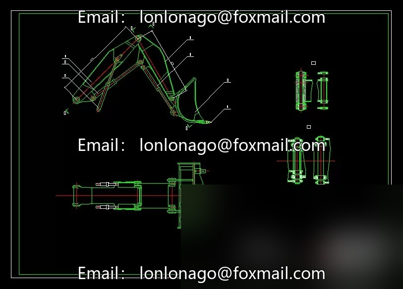
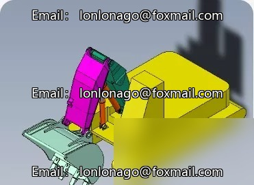
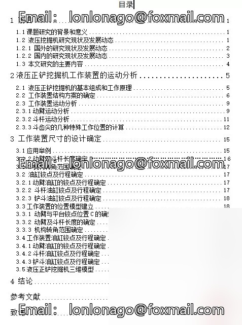

# Positive shovel working apparatus design; positive shovel working apparatus design drawing; positive shovel working apparatus design CAD

## Body

Positive shovel working device design, positive shovel working device design diagram, positive shovel working device design CAD diagram
This material is the design of hydraulic excavator positive shovel working device, and the design of the hydraulic excavator single shovel working device.
Containing 2 sets of references, each having a manual CAD figure and three-dimensional structure
549

The material covers the hydraulic excavator positive shovel work device design, including simulation models, physical models, images and videos, along with design drawings and machinery sketches.

<!-- AI_ENRICHED -->

## Images

## Payment

Here is a pay link on Stripe ( https://buy.stripe.com/3cs8yP7sY87d0vu9AB ). Please contact me lonlonago@foxmail.com after funding $89, and I will send you a complete data files , thank you!

